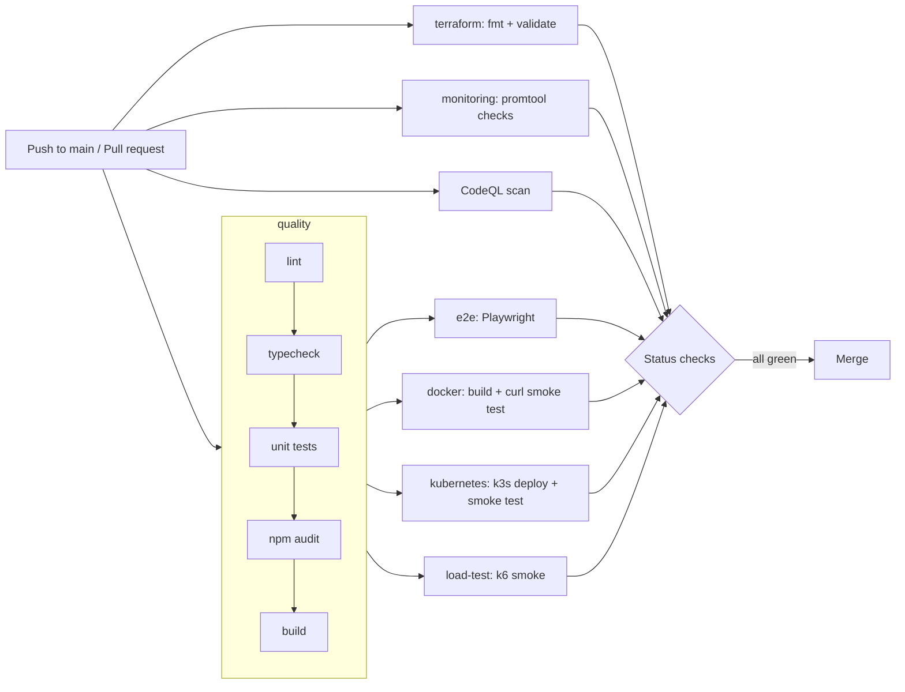
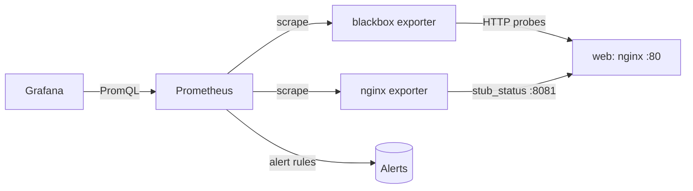

# Secure File Sharing System


A small web app where users sign up, upload files to a private store, and share them through short-lived signed links. Built with React and Supabase (Auth, Postgres, Storage).

## Features

- Email + password signup/login (minimum 6 characters)
- Protected dashboard with header (app name, user email, Logout)
- Upload via file picker or drag-and-drop, with client-side validation and a progress/loading state
- "My Files" table: name, size, type, upload date, Share and Delete
- Share modal: link expiry of 5 minutes, 1 hour or 24 hours, with Copy button and exact expiry time
- Share history: every generated link is logged (expiry only, never the URL) and shown as Active/Expired with time left
- Delete with confirmation (removes storage object and database row)
- Loading, error and success states throughout

## Tech stack

- Vite + React 19 + TypeScript
- React Router
- Supabase (`@supabase/supabase-js`): Auth, Postgres, Storage
- Plain CSS, no UI libraries
- Deployed on Vercel

## Security design

- **Private bucket** – `secure-files` is not public; objects are only reachable with an authenticated session or a signed URL.
- **Row Level Security** – `public.files` has RLS enabled; users can only select, insert and delete rows where `owner_id = auth.uid()`. There is no update policy.
- **Folder-per-user storage policies** – objects live at `<user_id>/<timestamp>-<sanitized filename>`. Policies on `storage.objects` only allow insert/select/delete when the first folder equals `auth.uid()`.
- **Expiring signed URLs** – sharing uses `createSignedUrl()` with a 5 min / 1 h / 24 h lifetime, so links stop working automatically.
- **Share log without secrets** – `public.share_links` stores only the expiry time of each link, never the signed URL. RLS lets a user read and insert only their own rows, and only for files they own; a check constraint caps the expiry at 24 hours.
- **Client-side file validation** – only PDF, PNG, JPEG, TXT and ZIP up to 10 MB are accepted before upload. The bucket also enforces the same limits server-side (`file_size_limit`, `allowed_mime_types`), so client checks are a convenience, not the only defence. Browser-specific MIME types (e.g. `application/x-zip-compressed` from Windows) are normalised to the canonical type before upload.
- The anon key is safe to expose in the browser because RLS and storage policies enforce access. Never put the `service_role` key in this app.

## Folder structure

```
.
├── supabase/schema.sql        # bucket, table, RLS and storage policies
├── src/
│   ├── lib/
│   │   ├── supabase.ts        # Supabase client + env check
│   │   ├── auth.tsx           # AuthProvider / useAuth
│   │   └── files.ts           # validation, formatting helpers, types
│   ├── components/
│   │   ├── ProtectedRoute.tsx
│   │   ├── UploadArea.tsx
│   │   ├── ShareModal.tsx
│   │   └── ConfirmDialog.tsx
│   ├── pages/
│   │   ├── Login.tsx
│   │   └── Dashboard.tsx
│   ├── App.tsx                # routes
│   ├── main.tsx
│   └── index.css
├── vercel.json                # SPA rewrite for React Router
├── .env.example
└── package.json
```

## Setup

1. **Create a Supabase project** at [supabase.com](https://supabase.com).
2. **Run the schema**: open the SQL Editor, paste the contents of `supabase/schema.sql`, and run it.
3. **Auth settings** (optional): under Authentication → Providers → Email you can disable "Confirm email" for easier local testing.
4. **Configure env**: copy the project URL and anon key (Project Settings → API) into `.env.local`:
   ```
   VITE_SUPABASE_URL=https://your-project.supabase.co
   VITE_SUPABASE_ANON_KEY=your-anon-key
   ```
5. **Run locally**:
   ```bash
   npm install
   npm run dev
   ```
6. **Deploy to Vercel**: push the repo to GitHub, import it in Vercel, add the two `VITE_` environment variables, and deploy. `vercel.json` rewrites all routes to `/index.html`. Add your Vercel URL to Supabase → Authentication → URL Configuration (Site URL).

## Notes

- `supabase-js` does not expose upload progress events, so the UI shows a per-file progress bar based on files completed plus an "Uploading…" state.

## DevOps

This project includes automated tests, a container image, a CI pipeline and security scanning.

### Pipeline



| Job | What it does |
| --- | --- |
| **quality** | `npm ci`, lint (oxlint), typecheck, Vitest unit tests, `npm audit --audit-level=high`, production build |
| **e2e** (needs quality) | Installs Chromium and runs the Playwright suite against a real Supabase test account; uploads the HTML report as an artifact (kept on failure too) |
| **monitoring** | Validates the Prometheus config and runs the alert-rule unit tests with `promtool` |
| **kubernetes** (needs quality) | Validates the manifests with kubeconform, deploys the image to a k3s cluster in Docker and smoke-tests it through the Service |
| **load-test** (needs quality) | Starts the container and runs the k6 smoke profile; fails on >1% errors or p95 > 500 ms |
| **terraform** | `terraform fmt -check`, `init` and `validate` for `infra/terraform` |
| **docker** (needs quality) | Builds the image with build args from secrets, starts the container and checks it returns HTTP 200 |

Runs on every push to `main` and every pull request. Outdated runs on the same branch are cancelled automatically.

**Required GitHub secrets** (Settings → Secrets and variables → Actions): `VITE_SUPABASE_URL`, `VITE_SUPABASE_ANON_KEY`, `E2E_EMAIL`, `E2E_PASSWORD`. Dependabot pull requests read secrets from a separate store, so add the same four under Settings → Secrets and variables → **Dependabot** as well.

### Tests

```bash
npm run typecheck   # TypeScript
npm test            # unit tests (Vitest): file validation, sanitizing, paths, formatting
npm run test:e2e    # end-to-end tests (Playwright, Chromium)
```

E2E tests need a dedicated, confirmed test user. Create one in Supabase (Authentication → Users → Add user, with Auto Confirm) and set these in `.env.local`:

```
E2E_EMAIL=
E2E_PASSWORD=
```

If any of the four variables (`VITE_SUPABASE_URL`, `VITE_SUPABASE_ANON_KEY`, `E2E_EMAIL`, `E2E_PASSWORD`) is missing, the E2E tests are skipped with a message. Every test removes the files it uploads, so the test account stays empty. The first run needs `npx playwright install chromium`. Set `E2E_BASE_URL=http://localhost:8080` to run the suite against an already-running build, such as the Docker container.

### Docker

The image is a two-stage build: `node:22-alpine` runs `npm ci` and `npm run build`, then `nginx:alpine` serves `dist/`. Supabase settings are baked in at build time via build args. `.env.local` is never copied into the image.

```bash
# docker compose (reads build args from .env.local), served on http://localhost:8080
npm run docker:up        # = docker compose --env-file .env.local up --build

# or plain docker
docker build \
  --build-arg VITE_SUPABASE_URL=https://YOUR-PROJECT.supabase.co \
  --build-arg VITE_SUPABASE_ANON_KEY=YOUR-PUBLISHABLE-KEY \
  -t secure-file-share .
docker run --rm -p 8080:80 secure-file-share
```

`nginx.conf` provides the SPA fallback, gzip, one-year caching for hashed `/assets`, no-cache for `index.html`, and security headers (`X-Content-Type-Options`, `X-Frame-Options`, `Referrer-Policy`, `Content-Security-Policy`). The CSP's `connect-src` is filled in with your Supabase URL when the container starts.

### Monitoring

The app can run with a local monitoring stack built from free, open-source Docker images. Nothing extra needs to be installed besides Docker.

```bash
npm run monitoring:up     # app + Prometheus + Grafana + exporters (reads .env.local)
npm run monitoring:down   # stop everything
```

| Service | URL | Purpose |
| --- | --- | --- |
| App | http://localhost:8080 | The nginx container |
| Prometheus | http://127.0.0.1:9090 | Collects metrics and evaluates alert rules |
| Grafana | http://127.0.0.1:3000 | "Secure File Share - Overview" dashboard (login `admin` / `GRAFANA_ADMIN_PASSWORD`, default `admin`) |



- **Uptime and response time**: the blackbox exporter probes `/` and `/login` every 15 seconds.
- **Security header check**: a second probe fails if `X-Content-Type-Options`, `X-Frame-Options` or `Content-Security-Policy` disappear.
- **nginx metrics**: an internal `stub_status` endpoint on port 8081 (never published to the host) feeds active connections and requests per second.
- **Alert rules** (`monitoring/prometheus/alerts.yml`): `SiteDown`, `NginxDown`, `SecurityHeadersMissing`, `SlowResponse`, `NginxExporterDown`, `HighActiveConnections`. Firing alerts appear in Prometheus (Alerts tab) and on the Grafana dashboard.
- **Alert unit tests** (`monitoring/prometheus/tests/alerts.test.yml`) run with `promtool` in the CI `monitoring` job, together with a config check.
- Grafana and Prometheus are bound to `127.0.0.1`, so they are not reachable from other machines. Set `GRAFANA_ADMIN_PASSWORD` in `.env.local` to change the Grafana password.

To see an alert fire, stop the app container (`docker stop <web container>`): after about a minute `SiteDown` and `NginxDown` turn red; start it again and they clear.

### Kubernetes

Manifests live in [`k8s/`](k8s/README.md): Deployment (2 replicas, probes, resource limits, rolling updates), Service, HorizontalPodAutoscaler (2–6 pods at 60% CPU), PodDisruptionBudget and NetworkPolicy, combined with Kustomize.

```bash
docker compose --env-file .env.local build
bash scripts/k8s-local.sh up      # k3s cluster in Docker + deploy + smoke test
bash scripts/k8s-local.sh down
```

### Load testing

[`load-test/`](load-test/README.md) contains a k6 script with smoke, load and stress profiles, run from the k6 Docker image. In a recorded stress run inside the k3s cluster, the autoscaler grew the deployment from 2 to 6 pods while serving 59,584 requests with 0% errors (p95 88.7 ms).

```bash
bash scripts/load-test.sh docker smoke
bash scripts/load-test.sh k8s stress
```

### Infrastructure as Code (Terraform)

[`infra/terraform/`](infra/terraform/README.md) provisions a load-balanced staging environment on Docker: a private network, N app containers, an nginx load balancer whose upstream list is generated from them, and the monitoring stack. Terraform runs from its Docker image.

```bash
bash scripts/terraform.sh init
bash scripts/terraform.sh apply -auto-approve -var app_replicas=3
bash scripts/terraform.sh destroy -auto-approve
```

### Security scanning

- **Dependabot** (`.github/dependabot.yml`): weekly updates for npm (minor and patch updates grouped into one PR), GitHub Actions and Docker.
- **CodeQL** (`.github/workflows/codeql.yml`): static analysis for JavaScript/TypeScript on push to `main`, on pull requests and weekly. Results appear under the repository's Security → Code scanning tab.
- **npm audit** runs in the `quality` job and fails the build on high or critical vulnerabilities.
